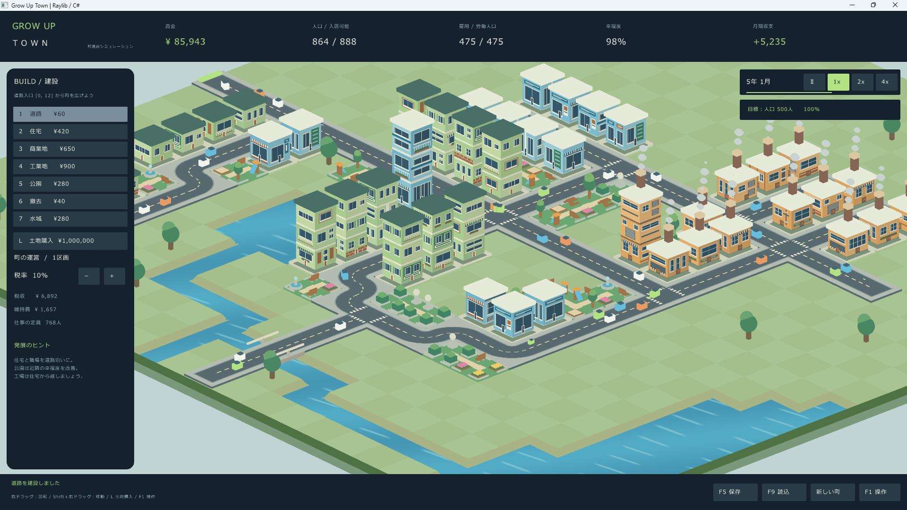
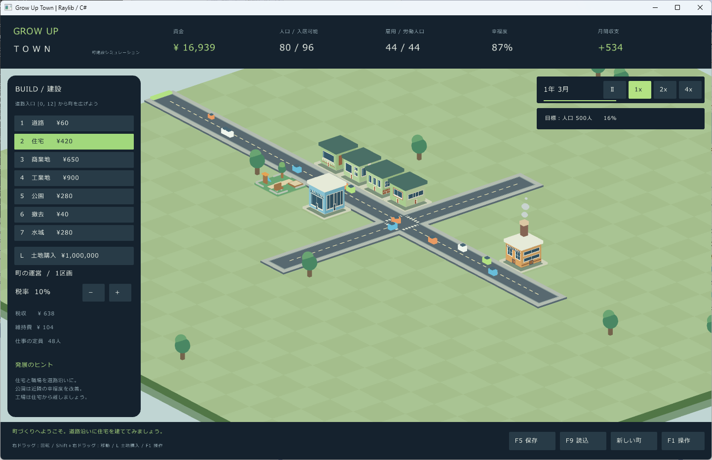

# Grow Up Town

小さな町を、大きな暮らしへ。

**Grow Up Town** は、道路を引き、住宅や職場を建てながら町を育てる、3D見下ろし型の町建設シミュレーションです。住民の暮らしと町の収支を見守りながら、人口500人を目指しましょう。目標を達成した後も、自由に町づくりを続けられます。

公園を並べて緑豊かな住宅街にしたり、川や池をつくって橋を架けたり。建物が成長し、道路を車が行き交う町を、好きな角度から眺めるのも楽しみのひとつです。



## ゲームの特徴

- **道路から始まる町づくり**：住宅・商業地・工業地を配置し、住まいと仕事のバランスを整えます。
- **暮らしに合わせて建物が成長**：通常建物は最大レベル3、super建築物は6、ultra複合都市は9まで自動で増築。さまざまな壁面や窓が町並みを彩ります。
- **年月とともに広がる建設メニュー**：大型住宅や複合ビル、4×4〜10×10マスの21種類のスペシャル施設が、60年まで順に解放されます。
- **鉄道のある町並み**：線路と駅を建設すると3両編成の列車が走り、踏切では車が停車します。駅を結ぶ路線は周辺の住宅と商業施設を支援します。
- **公園・森林と水辺で景観づくり**：隣り合う公園は園路がつながり、水域を並べれば川や池になります。40年からは道路接続が不要な森林も配置できます。
- **税率と収支のシンプルな運営**：税収を次の建設に使いながら、維持費と住民の幸福度に気を配ります。
- **土地を購入して町を拡張**：資金を蓄えて隣の区画へ。人口500人を超えても発展を楽しめます。

## 起動方法

Windows x64向けのゲームです。日本語表示にはWindowsのメイリオ、または游ゴシックを使用します。

配布用の `GrowUpTown.zip` を入手した場合は、ZIPの内容をすべて展開し、フォルダー内の `GrowUpTown.exe` を起動してください。同梱ファイルは同じフォルダーに置いたままにします。配布版には.NETの実行環境が含まれています。

以下のスクリーンショットは以前のバージョンの画面です。現在は建設メニューや情報表示が増えています。

ソースコードから起動する方法は、[開発・ビルド向けの説明](src/README.md)を参照してください。

## はじめての町づくり

最初は24×24マスの土地と16,000円の資金からスタートします。住宅4棟、商業地、工場、公園、町の外へつながる道路がすでにあるので、そこから少しずつ広げてみましょう。



1. **いったん時間を止める**：`Space` キーで一時停止すると、落ち着いて配置を考えられます。停止中も建設できます。
2. **道路を延ばす**：左の「道路」ボタン、または `1` キーで道路を選び、既存の道路からつなげます。ドラッグで連続配置できます。
3. **道路沿いに住宅と職場を建てる**：住宅だけでなく、商業地や工業地も用意します。工場は住宅から離して配置すると住環境を保ちやすくなります。
4. **公園や水辺を添える**：住宅の近くに置くと住環境が改善します。公園は道路につなげましょう。
5. **時間を進めて様子を見る**：`Space` キーで再開し、人口・幸福度・月間収支を確認します。通常速度では5秒で1か月進みます。
6. **こまめに保存する**：`F5` キーで保存します。自動保存はありません。

## 画面の見方

| 表示 | 確認できること |
| --- | --- |
| 資金 | 建設や維持費に使えるお金 |
| 人口 / 入居可能 | 現在の住民数と、道路につながった住宅の定員 |
| 雇用 / 労働人口 | 働いている人数と、仕事を必要とする人数 |
| 幸福度 | 町全体の暮らしやすさ。入居や建物の成長に影響 |
| 月間収支 | 直近の月の税収から維持費を引いた金額 |
| 左側の運営欄 | 税率、税収、維持費、仕事の定員 |
| 右上 | 年月、時間の停止・速度切り替え、人口目標の達成率 |
| 今、町に必要なもの | 住宅・職場の不足、成長に必要な労働者数、道路接続や幸福度についての案内 |

マップ上のマスにマウスを合わせると、建物の種類やレベル、道路接続の状態を確認できます。住宅では住民数と住環境も表示されます。

建設・撤去後の道路・鉄道接続と周辺効果は、バックグラウンドでまとめて再計算します。最後の編集から約0.35秒後、または更新予約から約2秒後に計算を始めるため、接続表示・住環境・収支への反映には少し遅れがあります。時間を停止していても更新は進み、更新待ちのまま保存することもできます。

「今、町に必要なもの」は、建設・撤去・月の経過・読込に応じて更新されます。住宅に十分な空きがあるのに労働者が不足している場合は、人口の増加を待ちましょう。住宅の定員自体が足りなければ、住宅を追加します。

`F2` で左の建設・運営パネル、`F3` で右の情報パネルを表示・非表示にできます。`Tab` で両方をまとめて隠し、両方が非表示なら再表示します。上部の表示ボタンからも戻せます。パネルを隠した場所でも建設やカメラ操作ができ、ショートカットキーも使えます。再起動時は両方表示されます。

## 建設メニュー

以下は開始時から使える通常の施設です。費用は1マスあたりです。住宅・商業地・工業地の維持費と定員は、建物のレベルに比例して増えます。

| キー | 種類 | 建設・撤去費 | 毎月の維持費 | 役割 |
| --- | --- | ---: | ---: | --- |
| `1` | 道路 | 60円 | 2円 | 町の入口と建物をつなぐ |
| `2` | 住宅 | 420円 | 5円 × レベル | 24人 × レベルが入居可能 |
| `3` | 商業地 | 650円 | 8円 × レベル | 16人 × レベルの職場 |
| `4` | 工業地 | 900円 | 14円 × レベル | 32人 × レベルの職場。周辺の住環境を下げる |
| `5` | 公園 | 280円 | 12円 | 道路につなぐと周辺の住環境を改善 |
| `6` | 撤去 | 40円 | — | 建物・道路・線路・公園・森林・水域を空き地に戻す |
| `7` | 水域 | 280円 | 12円 | 川や池をつくり、周辺の住環境を改善 |

左側のボタンでも種類を選べます。選択後、マップを左クリックすると建設・撤去します。道路・水域と、解放後の線路・森林は左ドラッグで連続配置できます。

既存の建物を別のものに変えるときは、先に撤去してください。例外として、水域には直接道路や線路を建設でき、道路と線路は重ねて踏切にできます。撤去しても建設費は返金されません。

### 年月による解放

開始時は1年1月です。次の施設は、画面に表示される年数を基準に、その年の1月から建設できます。

| 解放時期 | 使えるようになる施設 |
| --- | --- |
| 10年1月 | super住宅商業地 |
| 12年1月 | super工業商業地 |
| 15年1月 | super工業地 |
| 20年1月 | super住宅地 |
| 30年1月 | スペシャル4×4（大公園・スーパーマーケット・物流センター） |
| 35年1月 | スペシャル5×5（巨大水族館・大観覧車・ロボット研究所） |
| 40年1月 | 線路・駅・森林、スペシャル6×6（コンサートホール・ショッピングモール・宇宙開発センター） |
| 45年1月 | スペシャル7×7（動物園・遊園地・ロケット発射場） |
| 50年1月 | ultra複合都市、スペシャル8×8（温泉リゾート・大型スタジアム・自動車工場） |
| 55年1月 | スペシャル9×9（サファリパーク・カジノリゾート・未来エネルギー基地） |
| 60年1月 | スペシャル10×10（海洋リゾート・万博会場・超巨大メカ工廠） |

解放前の項目は「？」「¥？」と表示され、クリックやショートカットキーで選択できません。解放状態は保存した年月から引き継ぎ、新しい町を始めると再び開始時の状態になります。以前のセーブに解放前の施設があっても、その施設は稼働・成長・撤去できます。

### 大型建築：super・ultra

表の建設費は1棟全体の価格です。入居定員・雇用・毎月の維持費は、いずれも1レベルあたりの値で、レベルに比例して増えます。

| キー | 建築物 | 必要な空き地 | 建設費 | 入居定員 | 雇用 | 維持費/月 | 最大レベル |
| --- | --- | --- | ---: | ---: | ---: | ---: | ---: |
| `8` | super住宅商業地 | 2×2マス | 4,280円 | 96人 | 64人 | 52円 | 6 |
| `9` | super工業地 | 2×2マス | 3,600円 | — | 128人 | 56円 | 6 |
| `0` | super工業商業地 | 2×2マス | 6,200円 | — | 192人 | 88円 | 6 |
| `T` | super住宅地 | 2×2マス | 4,800円 | 192人 | — | 40円 | 6 |
| `U` | ultra複合都市 | 3×3マス | 18,000円 | 432人 | 240人 | 150円 | 9 |

super住宅商業地は住まいと店舗を兼ねた複合ビル、super工業地は大工場、super工業商業地は生産と商業・流通の複合ビルです。super住宅地は住宅専用のタワーマンションで、雇用枠はありません。

ultra複合都市は住宅・商業・工業をまとめたSF都市ビルです。最大レベル9で入居定員3,888人、雇用2,160人になります。super工業地・super工業商業地は周辺住宅の住環境を下げますが、ultra複合都市は公害を出しません。ただし、住宅部分は他の工場の公害を受けます。

大型施設は、クリックしたマスから座標のX・Zが増える方向に広がります。配置予定の枠を確認し、全体が購入済みの空き地に収まる場所へ建設してください。購入済みなら区画境界をまたいでも設置できます。外周のどこかが入口につながる道路に隣接すれば、1棟全体が稼働します。占有するマスのどこを撤去しても、**40円で1棟全体が撤去**されます。

### スペシャル施設

30年1月以降、左の「スペシャル」ボタンから専用の選択ウィンドウを開き、施設を選びます。一覧は1ページ4件で、全6ページです。選択ウィンドウを開いている間は時間と町の操作が止まります。施設を選ぶか、「閉じる」または `Esc` で戻ります。

最初の3施設は4×4マスの空き地が必要で、レベル1固定です。大型建築と同様に区画境界をまたいで建設でき、40円で全体を撤去できます。

| 施設 | 建設費 | 維持費/月 | 雇用 | 周辺への効果 |
| --- | ---: | ---: | ---: | --- |
| 大公園 | 5,600円 | 120円 | — | 住宅の住環境を道路接続時＋20、未接続時＋6 |
| スーパーマーケット | 7,200円 | 160円 | 64人 | 道路接続時、住宅の住環境＋10、商業部分の税収基準額＋20% |
| 物流センター | 8,400円 | 180円 | 96人 | 道路接続時、工業・商業部分の税収基準額＋20%。公害なし |

周辺効果は施設の外周から縦横の合計距離5マス以内に届き、super・ultraの該当する用途にも適用されます。対象も大型建築なら、その外周までの最短距離で判定します。雇用や税収には入口につながる道路への接続が必要です。

同じ種類のスーパーマーケットや物流センターを複数置いても、効果は重複しません。両方の範囲に入った商業部分は、元の税収基準額に対して合計＋40%になります。スペシャル施設自身には税収ボーナスが付きません。実際の税収は、町の稼働率と税率でも変わります。

大公園・スーパーマーケット・物流センターにはそれぞれ16種類の外観があります。設置時に周囲に合わせて選ばれ、その後は外観と向きが固定されます。

### 35年以降のスペシャル施設

以下の18施設もレベル1固定で、住宅定員・雇用・直接の税収・工業公害を持たず、周辺の建物を支援します。建設費と維持費は1施設全体の金額です。

| 解放時期 | 施設 | 必要な空き地 | 建設費 | 維持費/月 | 道路接続時の周辺効果 |
| --- | --- | --- | ---: | ---: | --- |
| 35年1月 | 巨大水族館 | 5×5マス | 12,000円 | 240円 | 住宅の住環境＋20 |
| 35年1月 | 大観覧車 | 5×5マス | 14,000円 | 260円 | 商業の税収基準額＋25% |
| 35年1月 | ロボット研究所 | 5×5マス | 16,000円 | 300円 | 工業の税収基準額＋25% |
| 40年1月 | コンサートホール | 6×6マス | 18,000円 | 360円 | 住宅の住環境＋25 |
| 40年1月 | ショッピングモール | 6×6マス | 22,000円 | 420円 | 商業の税収基準額＋30% |
| 40年1月 | 宇宙開発センター | 6×6マス | 26,000円 | 480円 | 工業の税収基準額＋30% |
| 45年1月 | 動物園 | 7×7マス | 28,000円 | 560円 | 住宅の住環境＋25 |
| 45年1月 | 遊園地 | 7×7マス | 32,000円 | 640円 | 商業の税収基準額＋35% |
| 45年1月 | ロケット発射場 | 7×7マス | 38,000円 | 760円 | 工業の税収基準額＋35% |
| 50年1月 | 温泉リゾート | 8×8マス | 42,000円 | 840円 | 住宅の住環境＋25 |
| 50年1月 | 大型スタジアム | 8×8マス | 48,000円 | 960円 | 商業の税収基準額＋40% |
| 50年1月 | 自動車工場 | 8×8マス | 56,000円 | 1,120円 | 工業の税収基準額＋40% |
| 55年1月 | サファリパーク | 9×9マス | 64,000円 | 1,260円 | 住宅の住環境＋25 |
| 55年1月 | カジノリゾート | 9×9マス | 72,000円 | 1,440円 | 商業の税収基準額＋45% |
| 55年1月 | 未来エネルギー基地 | 9×9マス | 84,000円 | 1,680円 | 工業の税収基準額＋45% |
| 60年1月 | 海洋リゾート | 10×10マス | 96,000円 | 1,890円 | 住宅の住環境＋25 |
| 60年1月 | 万博会場 | 10×10マス | 108,000円 | 2,160円 | 商業の税収基準額＋50% |
| 60年1月 | 超巨大メカ工廠 | 10×10マス | 126,000円 | 2,520円 | 工業の税収基準額＋50% |

効果は、施設と対象建物の敷地間の縦横の合計距離で、5×5施設なら5マス、6×6なら6マス、以降10×10なら10マス以内に届きます。super・ultraの該当する用途にも有効です。同種の効果は重複せず、異なる施設や鉄道の効果は加算します。住環境の上限は＋25で、税収支援は商業・工業それぞれの内訳に適用されます。

いずれも購入済みの空き地に設置でき、区画境界をまたいで建設できます。入口につながる道路が外周に接すると効果を発揮します。未接続でも維持費がかかり、占有マスのどこからでも40円で施設全体を撤去できます。自動車工場などの産業施設にも水域は必須ではありません。

各施設には16種類の外観があり、周囲との相性や近隣施設との重複を考慮して選ばれます。外観と向きは設置時に固定され、保存・読込後も変わりません。観覧車やロケット、施設内の車両などは固定表示です。

### 鉄道・駅・森林

40年1月から、左のメイン建設メニューと次のキーで選択できます。

| キー | 種類 | 必要な空き地 | 建設費 | 維持費/月 | 役割 |
| --- | --- | --- | ---: | ---: | --- |
| `B` | 線路 | 1×1マス | 100円 | 3円 | 駅を結ぶ。ドラッグで連続配置可能 |
| `N` | 駅 | 2×2マス | 4,800円 | 100円 | 異なる2駅以上を線路で結ぶと周辺を支援 |
| `G` | 森林 | 1×1マス | 420円 | 18円 | 道路接続なしで周囲3マスの住宅の住環境＋15 |

駅を新しく置くには、2×2マスの空き地の1辺に、その辺と平行な直線線路が2マス並んでいる必要があります。終端・カーブ・分岐・十字路は使えません。駅のホームは線路側、入口は道路側を向き、道路がなくても設置できます。駅には16種類の外観があり、外観・ホーム・入口の向きは設置時に固定されます。

異なる2駅以上を線路で結ぶと、各駅の敷地から縦横の合計距離5マス以内の住宅は住環境＋10、道路接続済みの商業部分は税収基準額＋20%になります。同じ鉄道効果は重複せず、ほかの支援施設と加算されます。駅同士を隣接させるだけでは効果はありません。三叉路では分岐できますが、十字路は直進のみで、交差する縦横の路線はつながりません。

道路と線路を重ねると踏切になり、維持費は道路2円＋線路3円の計5円/月です。列車が近づくと遮断機が下がり、車は手前で停止します。線路は水域にも敷設でき、直線の線路の両脇を水域にすると鉄道橋になります。踏切を撤去すると道路・線路の両方がなくなり、水域上の線路を撤去しても空き地になります。

線路には3両編成の列車が走り、ホームで約3秒、終端で約2秒停車します（1倍速時）。終端では車体の向きを変えずに反対側へ走り出します。列車と踏切の演出は時間の速度に連動し、一時停止中は止まります。表示範囲内の演出であり、列車の位置は保存されません。列車が見えることと駅の支援効果が有効であることは別なので、駅の接続表示も確認してください。

森林はドラッグで連続配置でき、複数の森林やほかの施設の住環境効果は上限＋25まで加算されます。公園の園路にはつながらず、道路や公園の接続を中継しません。16種類の外観があり、設置後も保存・読込後も維持されます。

## 町を発展させるには

### 道路を町の入口につなぐ

町の入口は、**最初の土地の西側にある座標 `[0, 12]` の道路**です。そこまで途切れずにつながる道路に、建物が上下左右のいずれかで隣接していると稼働します。斜めにつながっているだけでは使えません。

赤い枠の建物は道路未接続です。入口から建物までの道路を確認しましょう。土地を拡張した後も入口の位置は変わりません。

### 住宅と仕事をバランスよく増やす

住民の55%が労働人口になります。住宅に空きがあっても、職場が不足すると人口は伸びにくくなります。「雇用 / 労働人口」と「仕事の定員」を見ながら、住宅と職場を少しずつ増やしましょう。

条件が整った通常住宅には、1棟につき最大4人が毎月入居します。大型住宅部分の入居は、super住宅商業地で最大16人/月、super住宅地で32人/月、ultra複合都市で72人/月です。道路が切れたり、町の幸福度や住宅の住環境が悪化したりすると、住民が転出することもあります。

### 幸福度を保つ

通常住宅から縦横の移動で合計3マス以内にある公園や水域は、住環境を改善します。通常公園は道路接続時に1マスあたり＋10、未接続でも＋3の効果があります。水域は道路接続なしで1マスあたり＋10です。同じ範囲の工場は住環境を下げます。大公園やスーパーマーケットの効果を含めて、住環境の上限は＋25です。

高い税率、失業、資金の赤字も幸福度を下げる原因です。税率は左側の `−` / `＋` ボタンで5〜20%に調整できます。増税するときは、収入だけでなく幸福度の変化も見守りましょう。

### 建物の成長を待つ

通常建物とsuper・ultraの建築物は、道路につながり、幸福度60%以上を保ち、それぞれの条件を**6か月連続**で満たすと1レベル成長します。最大レベルは通常建物が3、superが6、ultraが9です。スペシャル施設は成長しません。

- 住宅を含む建物：入居定員の5/6以上が入居していること。通常住宅では現在のレベル × 20人以上です。
- 住宅を含まない商業・工業の建物：町の労働人口が、仕事の定員の55%以上あること。

成長すると入居定員や仕事の定員が増えますが、維持費も増えます。

### 収支を見ながら建てる

毎月、住民税と商業・工業の稼働状況に応じた税収が入り、道路や建物などの維持費が差し引かれます。道路に未接続の建物にも維持費はかかるため、使われていない施設を増やしすぎないようにしましょう。

資金がマイナスになってもゲームオーバーにはならず、時間は進みます。ただし、建設や撤去にはそれぞれの費用が必要です。

## 公園・川・橋をつくる

公園を上下左右に並べると芝生と園路がつながります。林、花壇、噴水、遊具などの装飾で、まとまった緑地をつくれます。

通常公園と大公園が上下左右につながっていれば、どこかが入口へ続く道路に面するだけで、ひと続きの公園全体が道路接続済みになります。園路は道路や大公園の方向にも伸びますが、入口につながっているかは接続表示で確認してください。公園経由の接続は住宅や職場、別の道路網には伝わりません。

水域は細く並べると川、広く並べると池になります。川を横切る道路をつくり、道路が直線につながっていて、その両脇が水域になっていると、自動で橋の見た目になります。

例えば東西に橋を架ける場合は、道路を東西につなぎ、各道路マスの北側と南側に水域を配置します。橋に追加の建設費・維持費はかかりません。**水域の上に建てた道路を撤去しても水域には戻らず、空き地になります。**

車は町の景観を楽しむための演出です。入口につながっていない道路にも現れるため、車の有無ではなく建物の接続表示で道路を確認してください。

## 土地を広げる

`L` キー、または「土地購入」ボタンで土地購入モードに入ります。所有地の上下左右に接する未購入の区画をクリックし、確認画面から購入してください。

- 1区画は24×24マスです。価格は初回 **1,000,000円**、2回目1,500,000円、3回目2,000,000円と、購入のたびに500,000円ずつ上がります。
- 最初から所有する区画は購入回数に含みません。購入のキャンセル・失敗では価格は上がらず、保存・読込後も次の価格を引き継ぎます。
- 斜めにしか接していない区画は購入できません。
- 購入した土地は売却できません。
- 区画数にゲーム上の固定上限はありませんが、拡張できる規模はPCのメモリなどにも左右されます。

画面外の町も発展しますが、更新はまとめて行われるため、ずっと表示していた場合と成長の結果が異なることがあります。

## 操作一覧

### 建設・町の運営

| 操作 | 内容 |
| --- | --- |
| `1`〜`7` / 左の建設ボタン | 建設・撤去ツールを選択 |
| `8` / `9` / `0` / `T` | super住宅商業地（10年） / super工業地（15年） / super工業商業地（12年） / super住宅地（20年）を選択 |
| `U` | ultra複合都市を選択（50年から） |
| `B` / `N` / `G` | 線路 / 駅 / 森林を選択（40年から） |
| 「スペシャル」ボタン | 解放済みのスペシャル施設を選択（30年から、60年まで順次追加） |
| 左クリック | 建設・撤去 |
| 左ドラッグ | 道路・線路・水域・森林の連続配置 |
| `L` | 土地購入モードの切り替え |
| `Esc` | 選択を解除、ダイアログや土地購入モードを閉じる |
| `Space` | 時間の停止・再開（再開時は1倍速） |
| 右上の速度ボタン | 停止 / 1倍速 / 2倍速 / 4倍速 |
| 税率の `−` / `＋` | 税率を変更 |
| `F5` / 「保存」 | 町を保存 |
| `F9` / 「読込」 | 保存した町を読み込む |
| `F1` / 「操作」 | ゲーム内の操作説明を表示 |
| `F2` / 上部の建設表示ボタン | 左の建設・運営パネルを表示・非表示 |
| `F3` / 上部の情報表示ボタン | 右の情報パネルを表示・非表示 |
| `Tab` | 両パネルを隠す。両方非表示なら再表示 |

### カメラ・画面

| 操作 | 内容 |
| --- | --- |
| `WASD` / 矢印キー | カメラを移動 |
| 中ボタンドラッグ | カメラを移動 |
| `Shift` + 右ドラッグ | カメラを移動 |
| 右ドラッグ | 左右で回転、上下で見下ろす角度を変更 |
| `Q` / `E` | カメラを回転 |
| `R` / `F` | 見下ろす角度を上げる / 下げる |
| `Shift` + ホイール | 見下ろす角度を調整 |
| ホイール | 拡大・縮小 |
| `Home` | カメラの位置・回転・角度・倍率を初期状態に戻す |
| `Alt` + `Enter` | 枠なし全画面とウィンドウ表示を切り替え |

マウスでカメラを操作するときは、マップ上からドラッグを始めてください。右ドラッグの移動・回転は、ドラッグ開始時に `Shift` を押しているかで決まります。

## 保存とゲームの続き

**自動保存はありません。終了前には `F5` キーで保存してください。** 保存は1スロットで、毎回上書きされます。次に起動したら `F9` キーで保存した町を読み込めます。読込時には、現在の未保存の町の状態が置き換わります。

保存先は、配布版・Release実行時では **`GrowUpTown.exe` と同じフォルダーの `city.json`** です。起動時の作業フォルダーには依存しません。バックアップしたい場合は、このファイルを別の場所にコピーしてください。

```text
GrowUpTown/
├─ GrowUpTown.exe
└─ city.json
```

Debug実行時は、`src/GrowUpTown.sln` と同じフォルダー内の `SaveData/city.json`（このリポジトリでは `src/SaveData/city.json`）に保存されます。

以前のバージョンの `%LOCALAPPDATA%\GrowUpTown\city.json` を使う場合は、そのファイルを新しい保存先へ手動でコピーしてから読み込んでください。自動移行はありません。

「新しい町」ボタンを押すと確認画面が開きます。新しく始めても保存ファイルは消えませんが、その後 `F5` キーで保存すると上書きされます。

現在の保存形式はVersion 3です。旧形式（Version 1・2）のセーブデータは読み込めません。

## 困ったときは

| 状況 | 確認すること |
| --- | --- |
| 建物に赤い枠が付く | 建設直後は接続の再計算を少し待ち、入口 `[0, 12]` から続く道路に建物が上下左右で隣接しているか確認してください。 |
| 人口が増えない | 時間が動いているか、住宅の空きと職場があるか、道路接続・幸福度・住環境に問題がないか確認してください。 |
| 建物が成長しない | 幸福度60%以上と入居・雇用の条件を6か月連続で満たす必要があります。通常はレベル3、superは6、ultraは9が上限です。スペシャル施設はレベル1固定です。 |
| 建設できない | 解放時期、資金、購入済みの土地、施設全体を置ける空き地を確認してください。既存施設は原則として先に撤去します。 |
| メニューが「？」になっている | superは種類により10・12・15・20年、ultraは50年、スペシャルは30〜60年、線路・駅・森林は40年の1月に解放されます。 |
| 駅を建設できない | 2×2の空き地の1辺に、辺と平行な直線線路が2マス並んでいるか確認してください。終端や分岐は使えません。 |
| 鉄道の周辺効果が出ない | 異なる2駅以上を線路で結び、再計算の完了を待ってください。十字路で交差する縦横の路線はつながりません。 |
| 左右のパネルが見えない | `F2`・`F3` または上部の表示ボタンで戻せます。両方隠れている場合は `Tab` でも戻せます。 |
| 町が見つからない / 視点を戻したい | `Home` キーで最初のカメラ位置に戻せます。 |
| 前回の町が表示されない | 新しい保存先に `city.json` があるか確認し、`F9` キーで読み込んでください。旧バージョンの保存は手動コピーが必要です。前回保存していない進行は復元できません。 |
